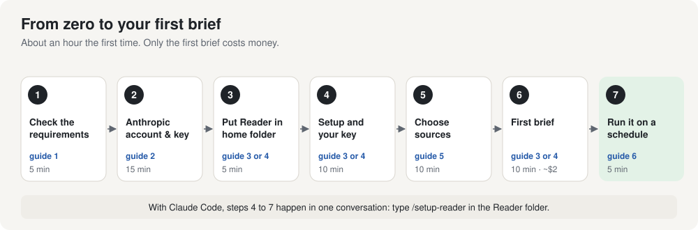

# Reader: an overnight markets brief

By [Strat & Story](https://stratandstory.com)

Reader goes through the overnight news on your Mac and writes a short brief for the New York morning: the stories that matter to markets, what happened in Asia and Europe while the U.S. slept, and the week's scheduled data releases. It reads about 60 publisher and official feeds. A separate AI model checks every factual sentence against its source, and every item links to the original publisher with its publication time.

It is built to say less rather than say something unsupported. On a quiet night the brief is short.

## How it keeps to its sources

- **No model browses.** Collection is plain code. The models see only items Reader actually fetched, each with its publisher and time, and code attaches every link, so no model can invent or garble a source.
- **A different model checks every claim.** The checker fetches each source again from the publisher, confirms, narrows or rejects each claim, and must quote the words that support it. Code confirms each quote appears word for word.
- **Code enforces what instructions can't.** Every number and name in a line of the brief must appear in the checked claims it cites, and a hedge such as "expected to" can't be dropped. A line that fails falls back to the checked claim's own wording.
- **Models are chosen by measurement.** Real past errors are kept as test cases and replayed against the live checker.

[How it works](docs/how-it-works.md) has the six stages, the rules and the run record.

## Requirements

| | |
|---|---|
| **Platform** | macOS. Setup, scheduling (launchd) and notifications use macOS's own tools. The pipeline itself is Python 3.11 or newer with three dependencies; other platforms are untested and unsupported. |
| **Host** | A Mac that stays awake and online through the week: a desktop Mac or Mac mini, or a MacBook kept on power with automatic sleep turned off. [Why](docs/guide/01-before-you-start.md#why-collection-runs-continuously) |
| **Resources** | Light, because the models run on Anthropic's servers. On the reference Mac a collection pass takes about 35 seconds, mostly network wait, with 2 seconds of CPU and 65 MB of memory; a cost estimate, which does all of a brief's local work except the model calls, peaks at about 110 MB. Disk: about 50 MB for Reader's Python environment, plus 1.5 to 2 MB of stored news a day. |
| **Network** | Outbound HTTPS only: each source's feed and its robots.txt every 30 minutes, and Anthropic's API while a brief is written. Nothing listens for incoming connections. |
| **Anthropic API** | An account with prepaid credit. A weekday brief costs about $2.50 to $3.50 and a quiet weekend morning about $1.50; a month of weekday briefs, about $55 to $75. Each run stops at a $4 ceiling, and you can set a monthly spending limit. |
| **Setup** | About an hour, and no programming. Claude Code can run the setup with you (it needs a paid Claude plan), or follow the Terminal guide. Every step is written out, with pictures. |

**Reference configuration.** Developed and run on a MacBook Air (Apple M2, 16 GB memory), macOS 15 Sequoia, Python 3.14, with the collector scheduled every 30 minutes since September 26, 2026.

**How it runs.** Reader is a set of scheduled background jobs, not a service. It checks every source every 30 minutes and writes the brief at 6:30 AM New York time, Monday to Friday. Many feeds list only their latest 20 or so items, so a complete brief depends on collection running across the whole span the brief covers: the previous trading day from that morning's brief, through the 4 PM close and the night that follows. If the Mac sleeps, Reader detects the checks it missed and lists them in the run report, and the brief still runs on what was collected.

## Two ways to set it up

| | **With Claude Code** (recommended) | **In Terminal, by yourself** |
|---|---|---|
| How it works | Claude, Anthropic's coding assistant, runs the setup with you in plain conversation and explains each step | You type a short series of commands, following the guide |
| You need | A paid Claude plan (Pro or above) for the Claude app | Nothing extra |
| Guide | [Set up with Claude Code](docs/guide/03-setup-with-claude-code.md) | [Set up in Terminal](docs/guide/04-setup-in-terminal.md) |

Whichever you choose, start with the first two guides.

## The guides

| | Guide | Time |
|---|---|---|
| 1 | [Before you start](docs/guide/01-before-you-start.md): requirements, costs, choosing the Mac, where Reader should live | 5 min |
| 2 | [Your Anthropic API key](docs/guide/02-api-key.md): account, credit, a spending cap, the key | 15 min |
| 3 | [Set up with Claude Code](docs/guide/03-setup-with-claude-code.md) | 30 min |
| 4 | [Set up in Terminal](docs/guide/04-setup-in-terminal.md) (instead of 3) | 30 min |
| 5 | [Sources and their terms](docs/guide/05-sources-and-terms.md): what Reader reads, what publishers allow, and your choice | 10 min |
| 6 | [Every morning](docs/guide/06-every-morning.md): reading the brief, running it automatically | 10 min |
| 7 | [Security and privacy](docs/guide/07-security-and-privacy.md): your key, what leaves your Mac, how to remove Reader | 10 min |
| 8 | [Troubleshooting](docs/guide/08-troubleshooting.md) | as needed |
| 9 | [Make it yours](docs/guide/09-make-it-yours.md): your companies, your audience, the brief's length | as needed |

Also: [How it works](docs/how-it-works.md) · [Every command](docs/commands.md) · [Every source and its terms](docs/sources-table.md)

## Read this before you rely on a brief

- **It is for your own reading.** Reader reads publishers' feeds for one person. Don't publish, post or resell the briefs, and don't run Reader as a service for others. [Sources and their terms](docs/guide/05-sources-and-terms.md) explains why, and asks you to choose which sources Reader may read. For use inside an organization, see [below](#for-organizations).
- **It can still be wrong.** Every line is checked against its source, and code enforces rules no model can talk its way around, but no checking is perfect. Before you act on anything, open the link.
- **It is not investment advice.** It reports what its sources reported.
- **It is independent.** Reader is not affiliated with Anthropic or with any publisher it reads.

## For organizations

This copy is for one person's own reading: most publishers allow their feeds for personal, non-commercial use and nothing more. Inside an organization, the same design works with sources the organization licenses, and with an audience, watchlist and brief fitted to its readers. Strat & Story sets up and adapts systems like Reader for organizations: [hello@stratandstory.com](mailto:hello@stratandstory.com).

## License

The code is released under the [Apache License 2.0](LICENSE): use it, change it and share it, including commercially. If you share it, keep the [NOTICE](NOTICE) file with it and mark the files you changed. The guides and illustrations are under [Creative Commons Attribution 4.0](LICENSE-docs.md). Publishers' content is theirs; neither license covers any of it. Copies published before this change were released under the MIT License and stay under it.

**The name.** Neither license grants rights to the Strat & Story name or mark. If you publish a modified version, don't present it as Strat & Story's or suggest Strat & Story endorses it; saying it is based on Reader by Strat & Story is welcome.

© 2026 Strat & Story LLC · [stratandstory.com](https://stratandstory.com) · [hello@stratandstory.com](mailto:hello@stratandstory.com)
