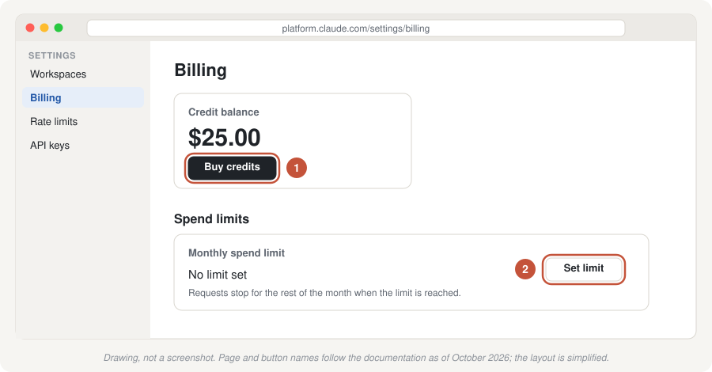
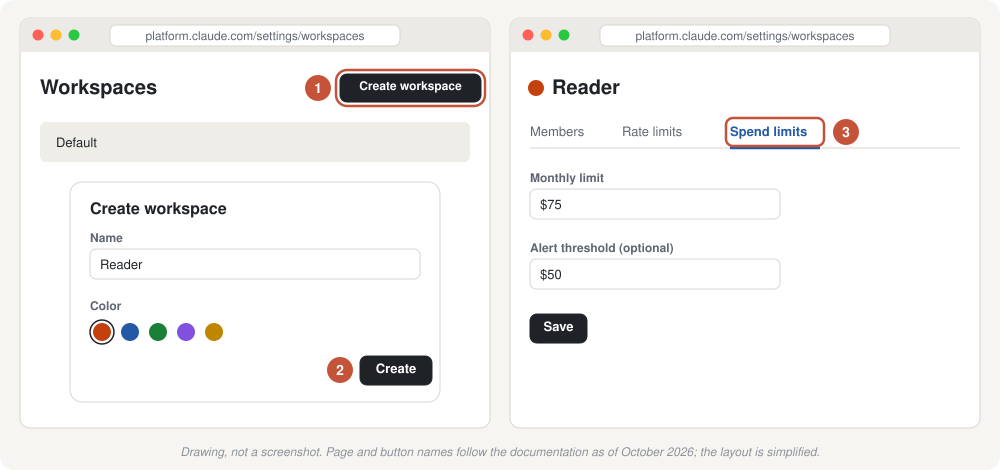
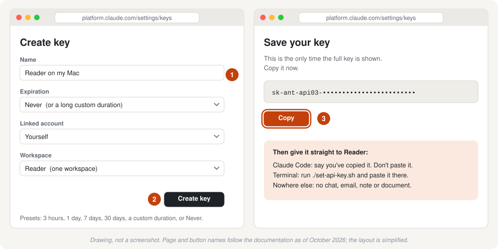
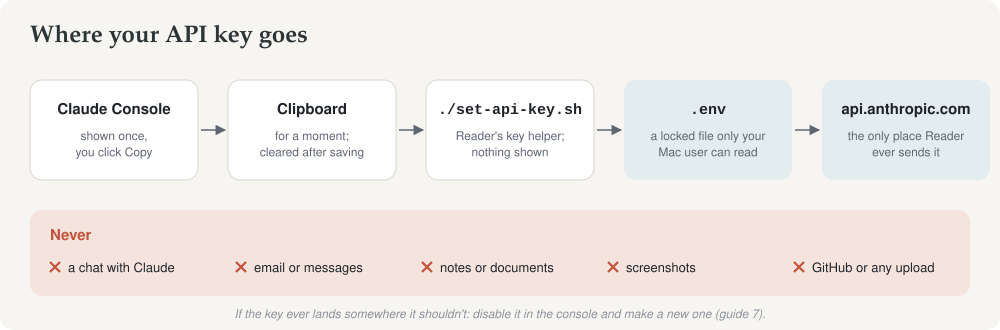

# 2. Your Anthropic API key

[← 1. Before you start](01-before-you-start.md) · Next: [3. Set up with Claude Code](03-setup-with-claude-code.md) or [4. Set up in Terminal](04-setup-in-terminal.md)

Reader uses Anthropic's AI models, and Anthropic needs to know who is paying. An **API key** is a long password, starting `sk-ant-`, that lets a program use your account's credit. You'll create one here and give it to Reader in the next guide.

Everything on this page happens in your web browser, in Anthropic's **Claude Console**. It takes about 15 minutes.

> **Treat the key like a bank card number.** Anyone who has it can spend your credit. You'll copy it once, give it straight to Reader, and never paste it anywhere else: not into a chat (including Claude), an email, a document or a note. [Guide 7](07-security-and-privacy.md) explains what to do if it ever leaks.

The pictures below are drawings, not screenshots. The labels match Anthropic's documentation as of October 2026, but the console's look may differ.

## Step 1. Create a Console account

1. Go to **[platform.claude.com](https://platform.claude.com)**.
2. Sign up or sign in. You can use the same email as your Claude app account, but the console account is separate.
3. If it asks for an organization name, use your own name. It's just a label.

**You'll see** the console's home page.

## Step 2. Add credit

1. Open **Settings**, then **Billing**.
2. Add credit to the account (look for **Buy credits**). **$25** is a sensible start: about ten weekday briefs.
3. If the page offers automatic reloading of credit, you can leave it off. When credit runs out, Reader's run stops and says why; nothing else happens.

## Step 3. Set a monthly spending limit (recommended)

A limit means a mistake can never cost more than you decide.

1. Still on **Settings → Billing**, find the **Spend limits** section.
2. Click **Set limit** (or **Adjust limit** if one is already set).
3. Enter a monthly amount. **$75** covers a month of weekday briefs with room to spare.

When the limit is reached, Reader's requests are refused until the next month (or until you raise the limit). Reader stops and reports it; nothing breaks.

## Step 4 (optional). A workspace just for Reader

A **workspace** is a compartment of your account with its own keys, usage and limits. If you use the console for anything else, a Reader workspace keeps its spending separate and lets you cap it on its own. If Reader is all you'll use it for, skip this step.

1. Go to **Settings → Workspaces** and click **Create workspace**.
2. Name it **Reader**, pick any color, and click **Create**.
3. Open the new workspace and its **Spend limits** tab. Set a monthly cap, and an alert if you like.

## Step 5. Create the key

1. Go to **Settings → API keys** and click **Create key**.
2. Fill in the form:
   - **Name:** something you'll recognise, such as `Reader on my Mac`.
   - **Expiration:** choose a long one. Reader runs every morning, and when its key expires the brief stops until you make a new one. Anthropic emails you a week before a key with a lifetime of 14 days or more expires. **Never** is also offered; it's the simplest, and you can still disable the key at any time.
   - **Linked account:** yourself.
   - **Workspace:** if the form lets you choose, pick **one** workspace (Reader if you made it in step 4, otherwise the default one) rather than all of them. A key for several workspaces works too, but Reader will then ask you for a workspace ID ([guide 8](08-troubleshooting.md#the-key-works-across-workspaces)).
3. Click to create it.

## Step 6. Copy the key, once

The console shows the full key **only once**, right after you create it. Leave the page open: in the next guide you'll copy it and hand it straight to Reader.

- If you close the page before saving the key, that's fine. You can't see it again, but you can create another one and delete the first.
- Don't save the key in a note or a document "for later". Reader keeps its own copy in a locked file ([guide 7](07-security-and-privacy.md)).

## A note on new accounts

New Anthropic accounts can start with lower usage limits while the account builds a history; Anthropic raises them automatically as you use the API. If an early run stops with a "rate limit" message, wait a few minutes and run it again. Your current limits are on the console's **Rate limits** page.

## A note on the checking model

Reader's checking and auditing use **Claude Fable 5.1**, Anthropic's most capable widely released model. It requires the account's standard 30-day data retention, which is how new accounts are set up, so you normally have nothing to do. The setup's `./brief doctor` step confirms your key can reach every model Reader uses.

Next: [3. Set up with Claude Code](03-setup-with-claude-code.md) (recommended) or [4. Set up in Terminal](04-setup-in-terminal.md)
