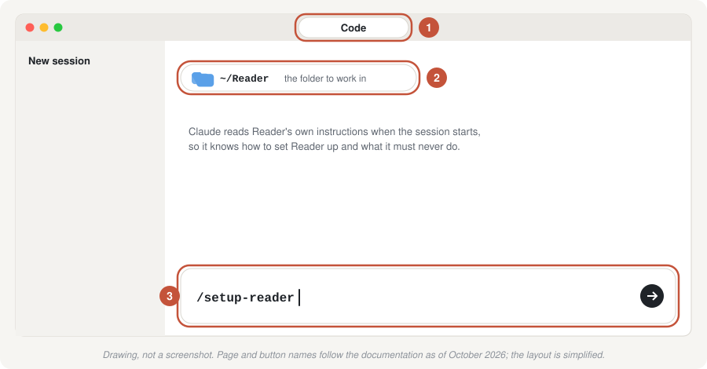
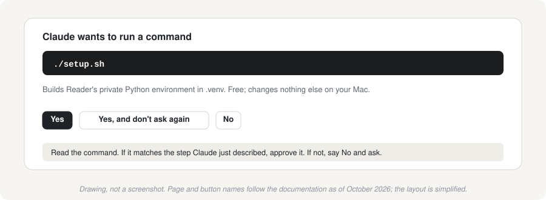

# 3. Set up with Claude Code

[← 2. Your Anthropic API key](02-api-key.md) · Next: [5. Sources and their terms](05-sources-and-terms.md)

This is the recommended route. **Claude Code** is Anthropic's coding assistant. In the Claude app for Mac it can read the Reader folder, run Reader's setup commands for you, explain what each one does and what it printed, and fix most problems as they come up. You talk to it in plain English.

Reader comes with instructions written for Claude Code, so it knows how to set Reader up, which steps cost money, and that it must never handle your API key in the conversation.

**You need:** the Claude app for Mac and a paid Claude plan (Pro or above), your Anthropic console open in the browser with credit added ([guide 2](02-api-key.md)), and about 30 minutes.

If you'd rather type the commands yourself, use [guide 4](04-setup-in-terminal.md) instead.

## Step 1. Install the Claude app and sign in

1. Download the Claude app for Mac from **[claude.ai/download](https://claude.ai/download)**.
2. Open the downloaded file and drag **Claude** into your **Applications** folder.
3. Open Claude from Applications and sign in with your Claude account (the one with the paid plan).

## Step 2. Install Python, if you don't have it

Reader needs Python 3.11 or newer. Claude will check in step 5 and tell you if it's missing. If you'd like to get it out of the way now:

1. Go to **[python.org/downloads](https://www.python.org/downloads/)** and click the button to download the latest Python 3 for macOS.
2. Open the downloaded installer and click through it (Continue, Agree, Install). It asks for your Mac password, as any installer does.
3. When it finishes, you can close the Finder window it opens.

## Step 3. Put Reader in your home folder

1. Open Reader's page on GitHub: **[github.com/stratandstory/reader-overnight-brief](https://github.com/stratandstory/reader-overnight-brief)**.
2. Click the green **Code** button, then **Download ZIP**.
3. Open your **Downloads** folder in Finder and double-click the ZIP file. You get a folder named `reader-overnight-brief-main`.
4. Rename that folder **Reader** (click it once, press Return, type `Reader`, press Return).
5. Move it into your **home folder**: in Finder choose **Go → Home**, then drag the Reader folder into that window.


It should end up at `~/Reader`, next to Desktop, Documents and Downloads, not inside them. [Guide 1](01-before-you-start.md#where-reader-should-live) explains why.

> **Comfortable with git?** Cloning the repository to `~/Reader` instead makes updates a single command later. Claude can do it for you: start a session in your home folder and ask it to clone the repository into `~/Reader`.

## Step 4. Open the Reader folder in Claude Code

1. In the Claude app, click the **Code** tab.
2. Start a new session and choose the **Reader** folder in your home folder as the folder to work in.



## Step 5. Ask Claude to set Reader up

Type this and press Return:

```
/setup-reader
```

(Or just write "Please set up Reader for me." It amounts to the same thing.)

Claude then works through the setup with you, one step at a time:

| Step | What Claude does | Costs |
|---|---|---|
| 1 | Checks your Mac, the folder's location and Python | free |
| 2 | Builds Reader's private Python environment (`./setup.sh`) | free |
| 3 | Saves your API key, without ever seeing it (below) | free |
| 4 | Confirms the key reaches every model Reader uses (`./brief doctor`) | free |
| 5 | Explains the sources and their terms, and asks which you want ([guide 5](05-sources-and-terms.md)) | free |
| 6 | Collects the night's news and shows which sources answered | free |
| 7 | Estimates the cost of a brief (`./brief dry-run`) | free |
| 8 | Writes your first brief, **after asking you** | about $1.50 to $3.50 |
| 9 | Sets up the schedule, if you want it, and shows you how to keep the Mac awake while it runs | free |

### Approving what Claude does

Before Claude runs a command or changes a file, the app may ask you to approve it. Read the line it shows you. If it matches the step Claude just described, approve it. If you don't understand it, choose No and ask Claude what it's for; it will explain.



Reader's folder includes settings that let Claude run the free setup steps and checks without asking each time, make it always ask you before anything that costs money or changes your Mac's schedule, and stop it opening the file where your key is kept.

### Saving your API key safely

Claude never needs to see your key, and you should never paste it into the conversation. When Claude reaches that step, it will ask you to:

1. Go to the browser tab with your new key ([guide 2, step 6](02-api-key.md#step-6-copy-the-key-once)) and click its **Copy** button.
2. Come back to Claude and say that you've copied it. **Don't paste it.**

Claude then runs `./set-api-key.sh --clipboard`. That small program takes the key straight from the clipboard, saves it in Reader's locked `.env` file, clears the clipboard, and prints a confirmation, never the key. The key never appears in the conversation.

If you paste the key into the chat by mistake, treat it as exposed: disable it in the console and create a new one ([guide 7](07-security-and-privacy.md#if-your-key-leaks)). It takes two minutes.

## Step 6. Your first brief

Claude will tell you the estimated cost and ask before it runs the first brief. It takes 5 to 10 minutes. When it's done, Claude opens the brief for you. It's a plain text file in the `briefs` folder; [guide 6](06-every-morning.md) shows how to read it.

## When you're done

You should have:

- a brief in `~/Reader/briefs/`
- your key saved, and `./brief doctor` reporting that it works
- your choice of sources saved
- if you chose it, the schedule running (`./schedule.sh status` says so)

From then on you don't need Claude for the daily routine. Come back to it when you want something changed or explained; type `/reader-checkup` for a health check that looks at your key, sources, schedule and last run, and explains anything wrong.

Next: [5. Sources and their terms](05-sources-and-terms.md), then [6. Every morning](06-every-morning.md)
