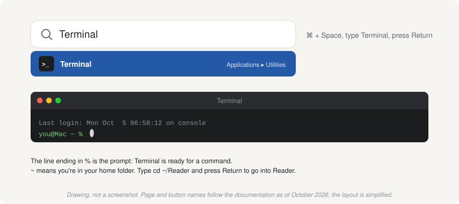
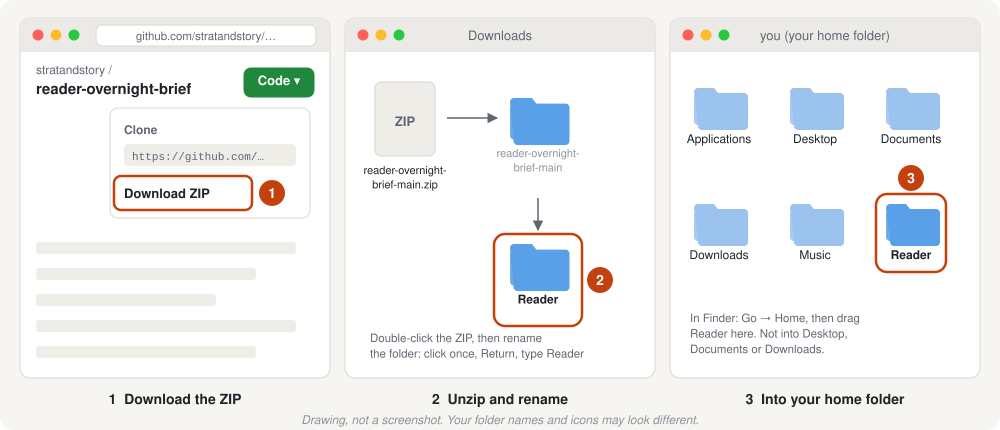
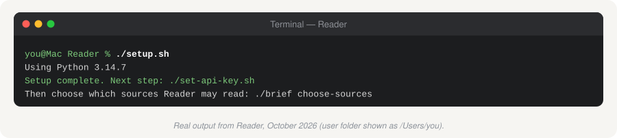
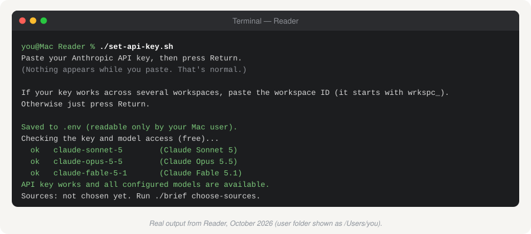
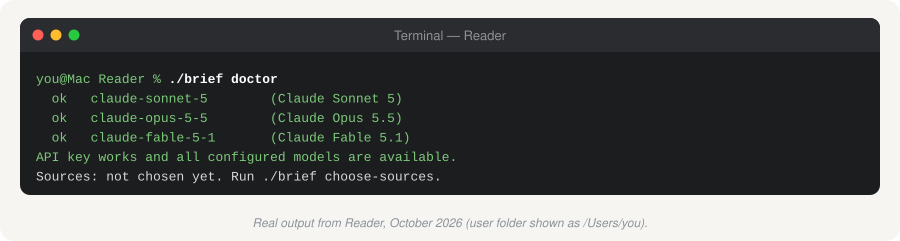
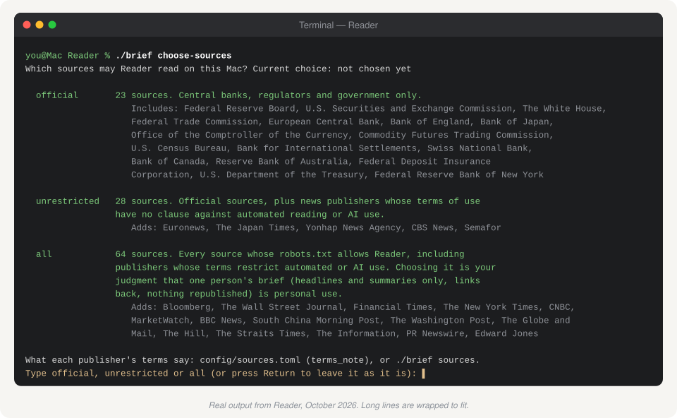
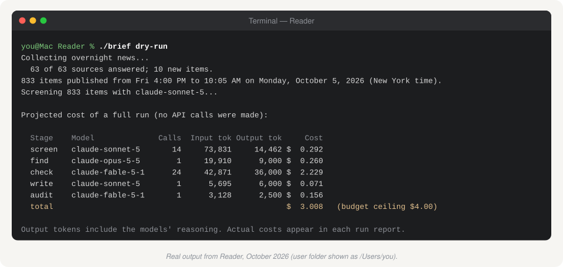
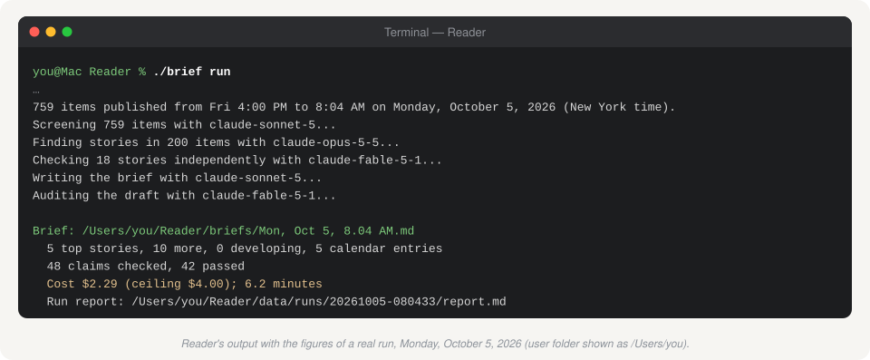
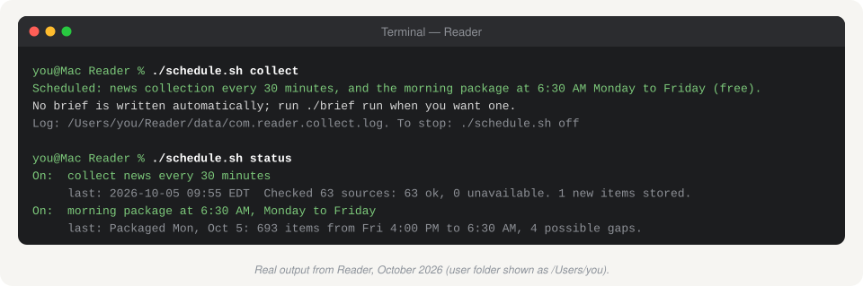

# 4. Set up in Terminal

[← 2. Your Anthropic API key](02-api-key.md) · Next: [5. Sources and their terms](05-sources-and-terms.md)

This route uses **Terminal**, the Mac's built-in app for typing commands. You'll type about ten short commands. Each one is shown below with what you should see afterwards. If something looks different, [Troubleshooting](08-troubleshooting.md) covers the usual causes.

**You need:** your Anthropic console open in the browser with credit added ([guide 2](02-api-key.md)), and about 30 minutes.

## How to use Terminal (two minutes)

- **Open it:** press **Command + Space**, type `Terminal`, press **Return**.
- **Run a command:** type it (or copy it from this page and paste with **Command + V**), then press **Return**.
- **Wait for the prompt:** a command is finished when the line ending in `%` appears again.
- **Stop something:** press **Control + C**.
- Commands are case-sensitive, and the `./` at the start of Reader's commands matters: it means "the program in this folder".



## Step 1. Install Python, if you don't have it

In Terminal, run:

```bash
python3 --version
```

- If it prints `Python 3.11` or any higher number (3.12, 3.13, 3.14), you're set. Go to step 2.
- If it prints a lower number, `command not found`, or a window pops up offering to install "command line developer tools", close that window and install Python from python.org:
  1. Go to **[python.org/downloads](https://www.python.org/downloads/)** and download the latest Python 3 for macOS.
  2. Open the installer and click through it (Continue, Agree, Install). It asks for your Mac password.
  3. Quit Terminal (**Command + Q**) and open it again, so it finds the new Python.

## Step 2. Put Reader in your home folder

1. Open Reader's page on GitHub, **[github.com/stratandstory/reader-overnight-brief](https://github.com/stratandstory/reader-overnight-brief)**, click the green **Code** button, then **Download ZIP**.
2. In Finder, open **Downloads** and double-click the ZIP. You get a folder named `reader-overnight-brief-main`.
3. Rename it **Reader**, then drag it into your home folder (**Go → Home** in Finder).



Then, in Terminal, go into the folder:

```bash
cd ~/Reader
```

Every command from here on is run from this folder. If you open a new Terminal window later, run `cd ~/Reader` first.

## Step 3. Build Reader's Python environment

```bash
./setup.sh
```

This creates a private copy of Python inside the Reader folder (in `.venv`) and installs the three packages Reader uses. It changes nothing else on your Mac. It takes about a minute.



## Step 4. Save your API key

1. In the browser, copy your new key ([guide 2, step 6](02-api-key.md#step-6-copy-the-key-once)).
2. In Terminal, run:

```bash
./set-api-key.sh
```

3. Paste the key when asked (**Command + V**) and press **Return**. **Nothing appears while you paste.** That's deliberate, so the key never shows on screen.
4. When it asks for a workspace ID, just press **Return**, unless you made a key for several workspaces in guide 2.

It saves the key in a file called `.env` that only your Mac user can read, then checks that the key works. That check is free.



**What success looks like:** a line for each model starting `ok`, then `API key works and all configured models are available.` If you see something else, see [Troubleshooting](08-troubleshooting.md#the-key).



## Step 5. Choose which sources Reader reads

Read [guide 5](05-sources-and-terms.md) first. It takes five minutes, and the choice is yours. Then run:

```bash
./brief choose-sources
```

It lists the three choices (`official`, `unrestricted`, `all`), how many sources each includes, and the publishers. Type your choice and press **Return**. You can change it at any time by running the same command.



## Step 6. Collect the news (free)

```bash
./brief collect
```

Reader checks every source you chose and stores what it finds. It takes about a minute. The last line says how many sources answered and how many items were stored. To see each source's status:

```bash
./brief sources
```

A source or two being unavailable is normal; sites have bad moments. Reader skips them and tries again next time.

## Step 7. See what a brief would cost (free)

```bash
./brief dry-run
```

This runs every step except the AI calls and prints the estimated cost by stage.



## Step 8. Write your first brief (about $1.50 to $3)

```bash
./brief run
```

It takes 5 to 10 minutes and prints each stage as it goes. At the end it gives the brief's location, how many claims were checked, and the exact cost.



To open the brief:

```bash
./brief open
```

[Guide 6](06-every-morning.md) shows how to read it.

## Step 9. Run it automatically (optional)

Reader can collect the news every 30 minutes overnight and, if you like, write the brief at 6:30 AM on weekdays. [Guide 6](06-every-morning.md#run-it-automatically) explains the two modes. In short:

```bash
./schedule.sh collect
```

collects overnight and saves each weekday morning's news at 6:30 AM; you run `./brief run` when you want the brief. Or:

```bash
./schedule.sh on
```

does the same and also writes the brief at 6:30 AM on weekdays, with a Mac notification when it's ready (about $50 to $65 a month).

To check what's scheduled: `./schedule.sh status`. To stop everything: `./schedule.sh off`.



Then set your Mac to stay awake overnight: [guide 6](06-every-morning.md#keep-the-mac-awake-overnight).

## You're done

You have a brief in `~/Reader/briefs/`, a working key, your choice of sources, and, if you chose, the overnight schedule.

Next: [5. Sources and their terms](05-sources-and-terms.md) if you haven't read it, then [6. Every morning](06-every-morning.md)
