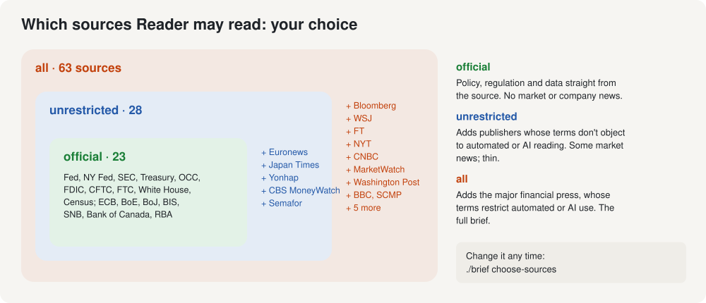

# 5. Sources and their terms

[← Setup](03-setup-with-claude-code.md) · Next: [6. Every morning](06-every-morning.md)

Reader reads other people's publications. This page explains how it reads them, what the publishers' own terms of use say about that, and the choice you make about which sources it may read. Reader won't fetch anything until you've made that choice.

This is a plain description of the facts, not legal advice. If the answer matters to you professionally, ask a lawyer.

## How Reader reads

Reader follows the same rules for every source:

- **The publisher's own feed or page only.** RSS feeds the publisher offers to the public, or an official body's own press-release page. No aggregators, no workarounds.
- **robots.txt respected.** Every website can publish a file saying which automated visitors may read which pages. Reader reads that file first, obeys it, and treats a site whose file can't be reached as saying no.
- **An honest name.** Reader identifies itself on every request as `ReaderBrief/0.1 (personal morning news brief)`. It never pretends to be a web browser.
- **Gently.** Each feed is checked once every 30 minutes.
- **Headlines and summaries only, for journalism.** Reader never fetches the text of a news article for the AI. It reads the headline and the short summary the publisher puts in its own feed. Official pages (central banks, regulators) and company press releases, which are published to be distributed, are read in full.
- **Links back.** Every item in the brief links to the publisher's own page.
- **Nothing republished.** The brief is for you.

Some sources Reader could reach are left out entirely: Reuters and AP publish no public feeds; The Guardian, The Telegraph, France 24 and Al Jazeera bar AI use of their content outright; several sites refuse automated visitors. Their entries in `config/sources.toml` say why.

## What the publishers' terms say

Being allowed in by robots.txt is not the same as the publisher's terms of use agreeing to what you do with the content. Strat & Story read the terms of every source on October 1, 2026, and each source in `config/sources.toml` now carries a summary (`terms_note`) and one of four labels:

| Label | Meaning | Sources |
|---|---|---:|
| **official** | A government, central bank or regulator publication (the Fed, the SEC, the Treasury, the ECB, the Bank of England and others) | 23 |
| **no-clause** | A news publisher whose terms have no clause against automated reading or AI use, or that publishes no terms (Euronews, The Japan Times, Yonhap, CBS News MoneyWatch, Semafor) | 5 |
| **restricts** | A publisher whose terms restrict automated access, AI use, or both | 35 |
| **not-read** | Terms not reviewed (Edward Jones's daily snapshot, shown as a link only and never given to the AI) | 1 |

The **restricts** group includes most of the major financial press. Their terms differ in what they restrict:

- **Named AI clauses.** Dow Jones (The Wall Street Journal, MarketWatch) bars AI use of its content "for training or grounding"; the Financial Times bars using AI tools to "generate any data or content" from it; The New York Times bars "retrieval-augmented generation", and the South China Morning Post reserves its content against it; The Washington Post bars using its content with AI tools to generate text; the BBC requires permission to use its content for AI or "computer analysis"; The Hill bars its content "in any AI product". Reader gives headlines and summaries to an AI model to write your brief, which is the kind of use these clauses describe.
- **Automated-access clauses.** Bloomberg, CNBC, The Hill, The Straits Times, The Globe and Mail, the South China Morning Post, The Information and PR Newswire bar robots or automated tools, in some cases "for any purpose". Reader is an automated tool.
- **Personal use.** Almost all of them allow their RSS feeds for personal, non-commercial use in a news reader.

[Every source and its terms](../sources-table.md) lists each one, with the summary of its clause and the date of the terms.

## Your choice



| Choice | What Reader reads | What the brief is like |
|---|---|---|
| `official` | 23 official sources only: the Federal Reserve, the New York Fed, the SEC, the Treasury, the OCC, the FDIC, the CFTC, the FTC, the White House, the Census Bureau, the ECB, the Bank of England, the Bank of Japan, the BIS, the Swiss National Bank, the Bank of Canada, the Reserve Bank of Australia | Policy, regulation and data, straight from the source. No market news, no company news. |
| `unrestricted` | The official sources, plus the five publishers whose terms don't object | Some market and international news. Thin compared with the financial press. |
| `all` | Every source robots.txt allows, 64 in all, including the major financial press | The full brief Reader was built to write. |

**The case for `all`:** one person's morning brief, reading headlines and summaries from the publishers' own feeds at a human pace, with links back and nothing republished, is personal use, and the terms were written against bulk copying, AI training and commercial resale. **The case against:** several of those terms bar AI use or automated access in so many words, whatever the scale. Which weighs more is your judgment. You can change your choice whenever you like.

To choose, or change your choice: Claude asks you during setup, or run

```bash
./brief choose-sources
```

and type `official`, `unrestricted` or `all`. Your choice is saved in `config/local.toml`, a settings file that belongs to your Mac alone.

To leave out one particular source, whatever your choice, add its id to the `off` list in `config/local.toml`, or ask Claude to do it:

```toml
[sources]
policy = "all"
off = ["bbc_business", "scmp_business"]
```

The ids are in [the source table](../sources-table.md).

## The rules, whatever you choose

- **The briefs are for you.** Don't publish them, post them online, send them out as a newsletter, or sell them. A brief reproduces publishers' reporting in short form; passing it around is a different thing from reading it yourself.
- **Don't run Reader for other people,** as a service or inside a company product.
- **Don't make it greedier.** Leave the 30-minute interval, the honest User-Agent and the robots.txt check as they are. Don't add sources by imitating a browser, getting past paywalls or logins, or fetching article text.
- **If a publisher asks you to stop, stop.** Turn its sources off.
- **Paying for the news is still the right thing to do.** Reader shows you headlines and links. To read the story, open the link; a subscription is how you read it in full and how the reporting gets paid for. Many of the links (WSJ, FT, Bloomberg, The Information) need one to read past the headline. A subscription doesn't by itself change what a publisher's terms say about automated or AI use; the [source table](../sources-table.md) has each publisher's terms.

Next: [6. Every morning](06-every-morning.md)
