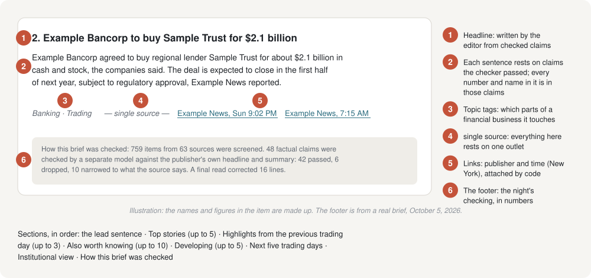
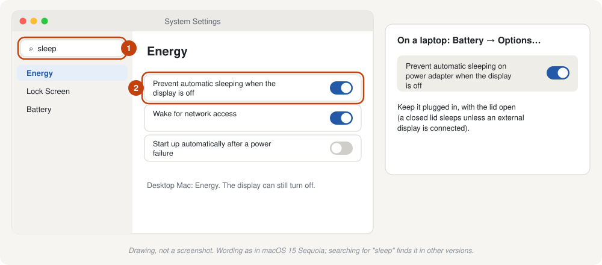

# 6. Every morning

[← 5. Sources and their terms](05-sources-and-terms.md) · Next: [7. Security and privacy](07-security-and-privacy.md)

## Getting the brief

**By hand.** Open Terminal and run:

```bash
cd ~/Reader
./brief run
```

It collects the latest news, then reads, checks and writes for 5 to 10 minutes, and prints the cost at the end. Then:

```bash
./brief open
```

opens the newest brief. Briefs are plain text files (Markdown) in `~/Reader/briefs/`, named by day and time, such as `Mon, Oct 5, 6.30 AM.md`. Any text editor opens them, and so does Finder's Quick Look (select the file, press Space).

**Automatically.** See [Run it automatically](#run-it-automatically) below.

## Reading the brief



A brief has up to seven parts. The numbers are ceilings, not targets: a quiet night gives a short brief.

| Part | What's in it |
|---|---|
| **The lead** | One sentence: the night's most important development. |
| **Top stories** | Up to five items, most important first. |
| **Highlights from Monday's trading day** | Up to three stories reported during the previous trading day, after that day's brief and before the 4 PM close, which no brief has carried. Named for the day: on a Monday morning it is Friday's. Everything else in the brief is overnight news. |
| **Also worth knowing** | Up to ten shorter items. |
| **Developing** | Up to five reports that rest on a single unconfirmed account from a second-tier outlet, named as such. |
| **Next five trading days** | Scheduled data releases and Fed meetings, from the agencies' published calendars, plus dated events from the night's news. |
| **Institutional view** | A link to one firm's published daily market note, for comparison. Never used as a source. |

Under each item:

- **Topic tags** (Trading · Wealth · Banking) say which parts of a financial business the item touches.
- **single source** means everything in the item rests on one outlet's reporting. Worth a second look before you rely on it.
- **update since …** means an earlier brief covered the story; the item reports what changed.
- **The links** go to each source, with the publisher's name and the time it was published, New York time. Times without a day are this morning; earlier ones carry the day.

The footer, **How this brief was checked**, gives the night's numbers: items read, claims checked, claims dropped or narrowed by the checker, lines corrected by the final read, and any source that couldn't be reached.

### How sure can you be?

Every factual sentence was checked by a second AI model against the publisher's own headline and summary (or the full official page), and code then confirmed that every number and name in each line appears in the checked material. That's strict, and it catches a lot. It isn't a guarantee. Open the link before you act on anything.

## The run report

Every run leaves a full record in `~/Reader/data/runs/<date-time>/report.md`: every claim checked and its verdict, what was dropped and why, what the final read corrected, and the cost of each stage. When something in a brief puzzles you, the answer is usually there. If you use Claude Code, ask it: "Why was the Fed story left out of this morning's brief?"

## Run it automatically

Reader can schedule itself on your Mac. There are two modes:

| Command | What it does | Cost |
|---|---|---|
| `./schedule.sh collect` | Collects the news every 30 minutes, day and night. At 6:30 AM on weekdays it also saves the morning's news as a package. You run `./brief run` yourself when you want a brief. | free; each brief you run costs as usual |
| `./schedule.sh on` | The same, and writes the brief at 6:30 AM, Monday to Friday, with a Mac notification when it's ready. | about $55 to $75 a month |
| `./schedule.sh status` | Shows what's scheduled and the last thing each job did. | free |
| `./schedule.sh off` | Removes every scheduled job. | free |

Run these from `~/Reader`, in Terminal, or ask Claude Code.

**Missed a morning?** If the schedule was collecting, the morning's news was saved at 6:30 AM. To write that morning's brief late:

```bash
./brief run --package 2026-10-06
```

(with that morning's date). It's marked as written late. It costs the same as a normal brief.

## Keep the Mac awake

The schedule runs only while the Mac is awake. If it sleeps, a job that was due runs when it wakes, but the half-hourly checks it slept through are lost, and on a busy day some headlines will have scrolled off their feeds. Each run report lists any such gaps. Because the brief covers the previous trading day as well as the night, keep the Mac awake around the clock on weekdays ([why](01-before-you-start.md#why-collection-runs-continuously)).

To keep it awake:

1. Open **System Settings** (Apple menu → System Settings).
2. Click the search box at the top of the sidebar and type **sleep**.
3. Turn on the option that **prevents automatic sleeping when the display is off**.
   - **Desktop Mac:** it's in **Energy**.
   - **MacBook:** it's under **Battery → Options**, and it applies while the MacBook is on its power adapter. Keep it plugged in, with the lid open.

The screen can still turn off; only the Mac itself needs to stay awake. The exact wording varies between macOS versions; searching for "sleep" finds it in each.



## Costs over time

Your spending is in the Claude Console under **Usage** and **Billing**. Each run also prints its exact cost, and every run report has a cost table by stage. If a month runs higher than expected, the usual reason is busier news: more items to read means more to check.

Next: [7. Security and privacy](07-security-and-privacy.md)
