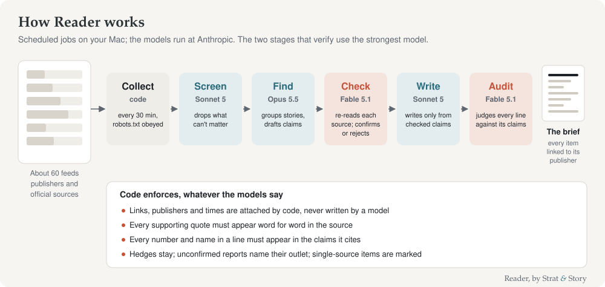

# How Reader works

[Back to the start](../README.md)

Reader's job is to tell a busy reader what happened overnight that matters to markets, and to state nothing its sources don't. The failure it is built against is the familiar one: an AI that fills gaps with plausible text so the job looks done. So the design leans the other way. When Reader can't support a sentence, the sentence goes. A short brief on a quiet night is the correct result.

## Six stages

| Stage | Done by | Job |
|---|---|---|
| **Collect** | code | Reads every chosen feed every 30 minutes and keeps what was published since the previous U.S. close. Company press releases are kept only if they name a company on your watchlist. |
| **Screen** | Claude Sonnet 5, low effort | Scores every headline for relevance and drops what can't matter. Tuned to keep borderline items, because nothing later can see an item the screen threw away. |
| **Find** | Claude Opus 5.5, high effort | The analyst. Reads the whole night, decides what the stories are, and drafts narrow factual claims, each citing the items it rests on. |
| **Check** | Claude Fable 5.1, medium effort | The independent checker. Fetches each source again from the publisher, and confirms, narrows or rejects every claim. It never sees the analyst's reasoning, and it's a different model. |
| **Write** | Claude Sonnet 5, high effort | The editor. Ranks the stories and writes the brief, using only claims that passed the check. Every sentence cites the claims behind it. |
| **Audit** | Claude Fable 5.1, medium effort | The last reader. Judges every headline and sentence against the claims it cites, and each item as a whole, and corrects or removes anything that says more than its claims. |

The rule behind the model choices: the stages that draft get a good model; the two that verify get the strongest; a verifying stage never uses the same model as the stage it checks, so their mistakes are less likely to coincide.

## Rules code enforces

Models can be persuaded; code can't. Whatever the models say:

- **Citations are attached by code.** The models refer to items by number. Links, publishers and times are filled in by Reader itself, so no model can invent or garble a source. A reference to an item that wasn't collected is rejected.
- **Quotes must be real.** The checker must quote the words in the source that support each claim. Code confirms each quote appears word for word; a claim without one is dropped, whatever the checker concluded.
- **Every number and every name** in a line of the brief must appear in the checked claims that line cites.
- **Hedges stay.** If a claim says "expected to", "plans to" or "would", the line can't state it as done.
- **Unconfirmed reports are labelled.** A report from one outlet's unnamed sources names the outlet. One that rests only on a second-tier outlet goes under **Developing**.
- **Single-source items are marked** "single source".
- **A line that fails** falls back to the checked claim's own wording, never to other AI-written text.

## How a claim earns its place

| Status | Meaning | Where it can appear |
|---|---|---|
| confirmed | an official source, or two independent outlets that each state the whole claim (outlets with the same owner count once) | anywhere |
| reported | stated as fact by one outlet | anywhere, with its source |
| attributed | an unconfirmed report ("people familiar with the matter") from a major outlet | anywhere, with the outlet named |
| developing | an unconfirmed report from a second-tier outlet only | Developing only |

## Memory

Reader keeps a local record of what earlier briefs reported, so the analyst can write what changed in a continuing story instead of retelling it ("update since Fri, Oct 2").

## The record

Every run writes a report: the funnel (items read, kept, grouped into stories, claims checked and passed), every claim with its verdict and sources, what the audit corrected, what was left out and why, and the cost of each stage. It's in `data/runs/<date-time>/report.md`.

## Costs

A weekday brief costs about $2.25 to $3; the checking stage is the largest part, which is where the money should go. Each run has a hard ceiling ($4 by default). Reader keeps costs in check by trimming what each stage reads (headlines and short summaries, not articles), caching the checker's instructions between calls, and limiting what the expensive models write, not by using weaker models where accuracy depends on them.

[Back to the start](../README.md)
